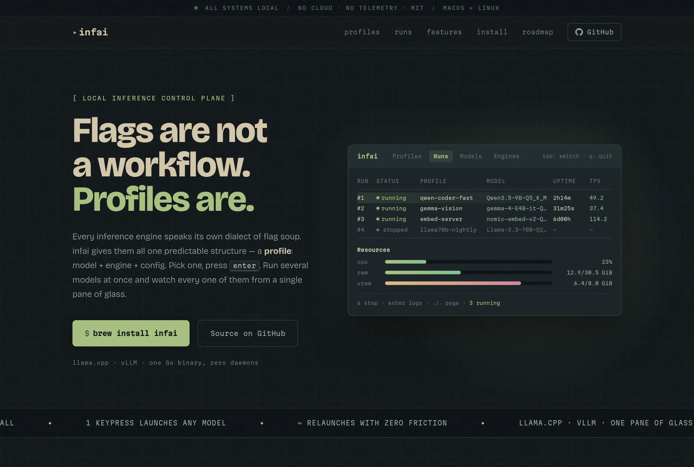

# infai

```
██╗███╗   ██╗███████╗ █████╗ ██╗
██║████╗  ██║██╔════╝██╔══██╗██║
██║██╔██╗ ██║█████╗  ███████║██║
██║██║╚██╗██║██╔══╝  ██╔══██║██║
██║██║ ╚████║██║     ██║  ██║██║
╚═╝╚═╝  ╚═══╝╚═╝     ╚═╝  ╚═╝╚═╝
```



**Two terminal tools for local-first AI, from one repository.**

| | What it is | Website |
|---|---|---|
| **infai** · engine | A control plane for local inference. Find or download a model, save a launch profile for llama.cpp or vLLM, and run and monitor many models from one TUI. | [infai.dipankar-das.com](https://infai.dipankar-das.com/) |
| **infaiw** · workflows | An agent harness that works with you, not around you. It runs as a background service with durable sessions, delegated sidecar loops, MCP, and approvals that wait for you. | [infai.dipankar-das.com/infaiw](https://infai.dipankar-das.com/infaiw/) |

Each is a single Go binary for macOS and Linux, released and installed separately.
Use either one on its own, or both together.

- [infai: local inference](#infai-local-inference)
- [infaiw: agent harness](#infaiw-agent-harness)
- [Building from source](#building-from-source)
- [Contributing](#contributing)

---

## infai: local inference

Every inference engine has its own dialect of flags. infai gives them one shape, the
**profile**: model + engine + config. Define it once, then launch it with a keypress.

### Install

```bash
brew install dipankardas011/tap/infai          # macOS and Linux
```

<details>
<summary>Other ways to install</summary>

- **Linux packages:** install `infai` from the
  [openSUSE Software portal](https://software.opensuse.org/download.html?project=home%3Adipankardas%3Ainfai&package=infai),
  which has repository setup for Debian, Ubuntu, Fedora, and openSUSE.
- **Script (Linux):** installs to `/usr/local/bin`.
  ```bash
  curl -sL https://raw.githubusercontent.com/dipankardas011/infai/main/install.sh | bash
  ```
- **Binary:** download one from [Releases](https://github.com/dipankardas011/infai/releases)
  (Linux and macOS, amd64 and arm64).

</details>

### Quick start

```bash
infai            # open the TUI
infai --version
```

On first launch infai creates its local database. In the **Engines** tab, add your
llama.cpp or vLLM binary. In the **Models** tab, add a model folder and press `s` to
sync it, or press `w` to download from Hugging Face. Then create a profile in
**Profiles** and press `enter` to launch it.

### Features

- **Profiles:** named launch configurations (context size, GPU layers, KV-cache types,
  flash attention, sampling, ports, extra flags), with engine-aware options for
  llama.cpp and vLLM.
- **Runs dashboard:** run several models at once, with status, uptime, and live
  tokens per second for each one. Ports are checked before launch.
- **Live telemetry and logs:** system and per-model CPU, RAM, and VRAM, plus a
  scrollable server log you can copy.
- **Model library:** scans folders for GGUF and SafeTensors files, reads their
  metadata, and links multimodal projectors automatically.
- **Hugging Face downloads:** search the Hub, pick a GGUF quantization, and download
  with resumable, atomic transfers. Provenance stays attached to the model.
- **Hardware-fit checks:** estimates whether a model fits your hardware and suggests
  launch settings before you start.
- **11 themes:** tokyonight, everforest, onedark, rosepine, gruvbox, catppuccin, nord,
  dracula, kanagawa, solarized, monokai.

### Keys

`tab` / `shift+tab` switch tabs, `t` picks a theme, `?` shows help, `q` quits.

| Tab or screen | Keys |
|---|---|
| Profiles | `enter` launch · `n` new · `e` edit · `x` delete · `/` filter |
| Runs | `enter` view · `s` stop · `r` restart · `x` remove · `pgup`/`pgdown` page |
| Models | `enter` info · `s` sync · `i` import · `w` download · `o` open on Hugging Face · `x` remove |
| Engines | `a` add · `e` rename · `x` delete |
| Profile editor | `ctrl+a` advanced options · `ctrl+s` save · `esc` discard |
| Server logs | `s` stop · `r` restart · `c` clear · `y` copy · `esc` back |

### Data

Profiles, folders, engines, and settings live in one SQLite file. Back it up with `cp`.

| OS | Path |
|---|---|
| Linux | `~/.config/infai/config.db` |
| macOS | `~/Library/Application Support/infai/config.db` |

Schema migrations run automatically on startup.

---

## infaiw: agent harness

infaiw runs agents as a background service, so a session keeps working after you
close the terminal. The `infaiw` TUI is a client: attach from several terminals,
leave, and come back to the same session.

- **Sidecar loops:** delegated subagents that are not done until an acceptance check
  passes. Each loop is its own session and is recorded on the timeline.
- **Durable, branching timelines:** every session is an event timeline that is
  compact to store and fast to replay, and you can branch from any point.
- **Human first:** approvals wait for you even after you close the window. Approve,
  deny, or deny with a reason.
- **Inter-session messaging:** sessions have mailboxes, and the engine routes messages
  between them.
- **Task checklists with intent:** each task records what was expected, so the agent
  can recover the goal mid-task.
- **Hybrid auto-compaction:** recent events stay verbatim and older ones are
  compressed.
- **Tools:** files, bash, web fetch and search, images in and out, skills, MCP servers
  (with OAuth, elicitation, and prompts), and evals.
- **Providers:** DeepSeek and OpenAI Codex, with configurable thinking levels.

### Install and start

The service is opt-in: installing the package does not start it. Run these as your
normal user, without `sudo`.

**Homebrew (macOS and Linux)**

```bash
brew install dipankardas011/tap/infaiw
brew services start infaiw
```

**Linux packages:** install `infaiw` from the
[openSUSE Software portal](https://software.opensuse.org/download.html?project=home%3Adipankardas%3Ainfai&package=infaiw), then:

```bash
systemctl --user daemon-reload
systemctl --user enable --now infaiw.service
```

### Quick start

```bash
infaiw provider login    # sign in to a model provider
infaiw                   # open the TUI and start a session
```

The TUI attaches to `localhost:6000` by default. Use `--host` and `--port` to reach
another server, and `--session <uuid>` to resume a saved session.

| Command | Does |
|---|---|
| `infaiw` | Open the chat TUI |
| `infaiw server` | Run the agent server in the foreground (the service runs this) |
| `infaiw provider list \| login \| logout` | Manage model provider credentials |
| `infaiw mcp list \| add \| edit \| remove \| refresh` | Manage MCP servers and their authorization |

### Keys

| Keys | Action |
|---|---|
| `ctrl+o` | Sessions |
| `ctrl+m` | Switch model |
| `ctrl+t` | Cycle thinking level |
| `ctrl+d` | Session stats |
| `ctrl+x` | Edit the message in your `$EDITOR` |
| `ctrl+v` / `ctrl+u` | Paste an image / clear attachments |
| `/` | Commands, skills, and MCP prompts |
| `←` `→` `enter` | Choose and answer a pending approval (`ctrl+g` for detail) |
| `ctrl+c` | Quit the TUI (the session keeps running) |

### Running the service

<details>
<summary>Homebrew</summary>

Homebrew manages launchd on macOS and systemd on Linux. Use
`brew services stop infaiw` or `brew services restart infaiw`. Logs are in
`$(brew --prefix)/var/log/infaiw.log`. Upgrading the formula stops a running
`infaiw server`, and the service starts the new binary; an inactive service stays
inactive.

If you installed the old cask, migrate once:

```bash
brew uninstall --cask infaiw
brew update
brew install dipankardas011/tap/infaiw
brew services start infaiw
```

The executable moves from the Caskroom to the Cellar. Your user data is not moved
or removed.

</details>

<details>
<summary>systemd (Linux packages)</summary>

- `--user` runs the service as your account, not root.
- `enable` starts it on future logins; `--now` also starts it immediately.
- Follow the logs with `journalctl --user -u infaiw.service -f` (`ctrl+c` stops
  following, not the server).
- Package upgrades restart running instances; inactive ones stay inactive.
- Stop it and disable startup with `systemctl --user disable --now infaiw.service`.
  Your data and configuration are kept.

Without lingering, a user service stops after your last session ends. To keep it
running after logout and start it at boot (may need admin rights):

```bash
sudo loginctl enable-linger "$USER"
```

Packaging follows the [Homebrew service DSL](https://docs.brew.sh/Formula-Cookbook#service-files),
[openSUSE unit guidelines](https://en.opensuse.org/openSUSE:Systemd_packaging_guidelines),
and Debian's [dh_installsystemduser](https://manpages.debian.org/bookworm/debhelper/dh_installsystemduser.1.en.html)
with `--no-enable`.

</details>

### Configuration

`infaiw server` is configured only through `INFAI_AGENT_*` environment variables, for
example `INFAI_AGENT_PORT=6000`. Background services do not inherit your shell
environment, so put them in `~/.config/infaiw/server.env` (`chmod 600` if it holds
secrets) and restart the service.

---

## Building from source

Requires Go 1.26+. infai also needs a C compiler, because it uses SQLite through CGO;
infaiw does not.

```bash
git clone https://github.com/dipankardas011/infai.git
cd infai
CGO_ENABLED=1 go build -o infai ./cmd/inference
CGO_ENABLED=0 go build -o infaiw ./cmd/agent
go test ./...
```

## Contributing

Bug reports and pull requests are welcome on
[GitHub](https://github.com/dipankardas011/infai). See [AGENTS.md](AGENTS.md) for the
architecture and conventions.

The website lives on the `gh-pages` branch; edit it by committing there. Provider
catalogs are the exception: they live in `catalog/` on `main`, next to the code that
reads them.

infaiw is being built in public, one post a day; follow along from the
[build log](https://infai.dipankar-das.com/infaiw/#buildlog).

## License

[Apache 2.0](LICENSE)
